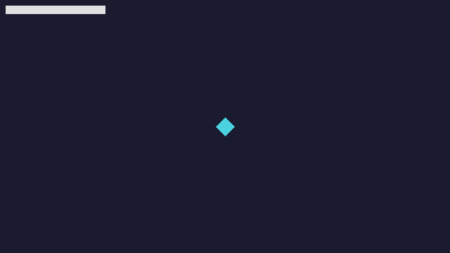
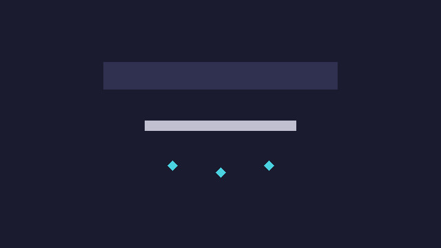

# Getting Started

Go from a clean machine to a running game in about ten minutes. You need the
**JDK 17** and nothing else - the Gradle wrapper is bundled with the project.

This guide is the executable version of the onboarding flow in
[`design/03-onboarding-flow.md`](design/03-onboarding-flow.md). Every step lists
what you should see on success and what to do if it fails.

> **OS-safe commands.** Commands are shown per platform:
>
> | | Windows (cmd / PowerShell) | macOS / Linux |
> |---|---|---|
> | Gradle wrapper | `gradlew.bat` | `./gradlew` |
>
> Use the Windows column on Windows. `./gradlew` does **not** work in Windows
> `cmd` or PowerShell.

---

## 1. What you'll build

First the "Hello Engine" window - one sprite and one line of text:



Then the full Gem Dash sample game:



## 2. Prerequisites

| Requirement | Notes |
|---|---|
| **JDK 17** (LTS) | [Eclipse Temurin 17](https://adoptium.net/temurin/releases/?version=17) or any OpenJDK 17. This is the version the engine builds and CI use. |
| Gradle | **Not required.** Use the wrapper that ships with the project. |
| OS | Windows 10+, macOS 11+, or a modern Linux. |
| GPU | OpenGL 3.3+ (any 2012+ integrated or dedicated GPU). |
| Internet | The first build downloads dependencies (Gradle + engine). |

Check your JDK:

```sh
java -version
```

**Success.** You see `openjdk version "17.x"` (or Temurin/Adoptium 17).

**If it fails.** If it prints Java 8, 11, or 21, or "java is not recognized",
see [JDK not found / wrong version](#jdk-not-found--wrong-version).

## 3. Get the project and run it

The onboarding template is `hello-engine`, which lives in the engine monorepo at
`templates/hello-engine`. It is also published as a downloadable archive,
`hello-engine-<version>.zip`, attached to each release.

### Option A - git clone (recommended)

```sh
git clone https://github.com/stratixops/stratix-engine.git
cd stratix-engine/templates/hello-engine
```

### Option B - release archive

Download `hello-engine-<version>.zip` from the
[releases page](https://github.com/stratixops/stratix-engine/releases), unzip it
so you have a `hello-engine/` folder, then `cd` into it.

### Run the starter

Windows:

```bat
gradlew.bat run
```

macOS / Linux:

```sh
./gradlew run
```

**Success.** The first run downloads Gradle and dependencies. When it finishes:

- The terminal prints something like `BUILD SUCCESSFUL in 47s` and then the window
  is open. Gradle keeps running while the window is open.
- A 1280x720 window titled **Hello Engine** opens, showing a centered cyan
  diamond and the text `Hello, engine!` in the top-left corner.
- Closing the window prints `BUILD SUCCESSFUL` (or `BUILD FAILED` if you closed
  it with an error code) and returns you to the prompt.

**Timing.** A **warm** run (dependencies already downloaded) opens the window in
**well under 10 seconds**. A **cold** run (the first-ever download of Gradle and
the engine) has no wall-clock limit - it only has to *complete without
intervention*: no prompts, no manual steps. Link speed dominates that first run;
if it hangs, see [Corporate proxy](#corporate-proxy--gradle-downloads).

**If it fails.**

| What you see | Fix |
|---|---|
| `./gradlew: Permission denied` | `chmod +x gradlew` then retry. See [Wrapper permission denied](#wrapper-permission-denied). |
| Downloads hang or `Could not resolve` / `Connection timed out` | Corporate proxy. See [Corporate proxy](#corporate-proxy--gradle-downloads). |
| Windows SmartScreen popup, or the window never appears and the firewall asks about `java.exe` | See [Windows SmartScreen / firewall](#windows-smartscreen--firewall). |
| `Failed to create an OpenGL 3.3 context` | See [Window does not open / OpenGL 3.3](#window-does-not-open--opengl-33). |
| `error: invalid source release: 17` / Gradle picks the wrong JDK | See [JDK not found / wrong version](#jdk-not-found--wrong-version). |

### Run the full sample

Windows:

```bat
gradlew.bat runSample
```

macOS / Linux:

```sh
./gradlew runSample
```

**Success.** A window opens on the Gem Dash **title screen**
(`Press SPACE / ENTER to start`).

**If it fails.** `Could not find or load main class io.stratixops.gemdash.Main`
means the engine sample artifact is not available on this machine yet - the
sample ships with the engine. See
[Sample not found](#sample-not-found-could-not-find-or-load-main-class) and make
sure you built the engine artefact first.

## 4. Your first game

Open `src/main/java/io/stratixops/hello/MyGame.java`. The file you just ran is
this, line by line:

> Steps 4-10 show focused excerpts to add to `MyGame.java` (fields, then the
> lifecycle methods), not complete standalone files. The template's
> `MyGame.java` is the source of truth; each excerpt builds on the previous
> step.

```java
public final class MyGame implements GameLifecycle {
    private Sprite logo;

    @Override
    public void onCreate(EngineContext ctx) {
        logo = ctx.assets().sprite("images/logo.png");   // cached, fails fast
    }

    @Override
    public void onRender(Renderer r, float alpha) {
        r.clear(0x1B1B2FFF);
        r.draw(logo, 320, 180);                          // centered by anchor
        r.drawText("Hello, engine!", 8, 8);
    }
}
```

- `implements GameLifecycle` - the one interface the engine calls. No base class,
  no `init()` sequence.
- `onCreate(EngineContext ctx)` - runs once after the window exists. `ctx` is how
  you reach assets, input, audio, and time.
- `ctx.assets().sprite(path)` - loads and caches a PNG from
  `src/main/resources/`. Registration/config errors fail fast; a missing
  runtime asset logs the path and draws a magenta placeholder (see the
  [missing-asset policy](#missing-asset-error)).
- `onRender(Renderer r, float alpha)` - runs every frame. `alpha` is the engine's
  interpolation factor in `[0,1)` between the previous and current update; forward
  it to `draw` for smooth motion, or ignore it if you don't interpolate.
- `r.clear(0x1B1B2FFF)` - fills the frame. Colors are `0xRRGGBBAA`.
- `r.draw(sprite, 320, 180)` - draws centered on the point. `(320, 180)` is the
  center of the 640x360 logical viewport.

**Success.** You changed nothing yet - the window looks exactly as before.
Congratulations, you've read the whole first game.

**If it fails.** Nothing to run yet. If your editor shows red underlines, the
engine dependency has not been resolved. See
[Sample not found](#sample-not-found-could-not-find-or-load-main-class).

## 5. Add your own sprite

1. Put a PNG in `src/main/resources/images/` (the template ships `logo.png`).
2. In `MyGame.java`, change `TODO 1` to your file name:

```java
private static final String LOGO = "images/my-sprite.png";
```

3. Move or resize it by changing `TODO 3`:

```java
r.draw(logo, 160, 100);
```

Run again (`gradlew.bat run` / `./gradlew run`).

**Success.** The window shows your image instead of the diamond, at the new
position.

**If it fails.** If the file is missing or mis-cased, the game **keeps running**
and the sprite is replaced by a magenta placeholder. The log names the exact
path, e.g.:

```
[warn] Missing asset: images/my-sprite.png (looked in src/main/resources/images/my-sprite.png); using placeholder
```

Paths are case-sensitive even on Windows/macOS. Root paths are relative to
`src/main/resources/`. See
[Missing asset error](#missing-asset-error).

## 6. Bind actions

Before moving with the keyboard, you bind **named actions** to keys. This keeps
game code free of raw key codes and makes controls rebindable.

The template ships `controls.json`:

```json
{
  "actions": {
    "Move":    { "keys": ["W", "A", "S", "D", "UP", "LEFT", "DOWN", "RIGHT"] },
    "Confirm": { "keys": ["SPACE", "ENTER"] },
    "Pause":   { "keys": ["ESCAPE", "P"] },
    "Mute":    { "keys": ["M"] },
    "Retry":   { "keys": ["R"] }
  }
}
```

You can also bind in code, which is what the sample does:

```java
private Input input;

@Override
public void onCreate(EngineContext ctx) {
    input = ctx.input().bind(ActionMap.def()
        .axis("Move", Key.W, Key.A, Key.S, Key.D)
        .axis("Move", Key.UP, Key.LEFT, Key.DOWN, Key.RIGHT)
        .build());
}
```

The engine resolves the `Move` axis from every key bound to it. Registering the
same action twice **merges** the bindings (it does not replace them).

**Success.** The project still runs unchanged. You now have an `input` field to
use in the next step.

**If it fails.** `Unknown action "Move"` means the action was queried before it
was bound, or `controls.json` was not found. Check the spelling and the file
location (next to `build.gradle.kts`).

## 7. Add movement

Add a position field and speed, then read the axis each update:

```java
private static final float SPEED = 120f;       // logical pixels per second
private final Vec2 position = new Vec2(320, 180);

@Override
public void onUpdate(float dt) {
    Vec2 move = input.axis("Move");            // magnitude-preserving Vec2
    position.x += move.x * SPEED * dt;         // dt = seconds since last frame
    position.y += move.y * SPEED * dt;
}

@Override
public void onRender(Renderer r, float alpha) {
    r.clear(0x1B1B2FFF);
    r.draw(logo, position.x, position.y);      // draw at the moving position
    r.drawText("Hello, engine!", 8, 8);
}
```

`dt` is the time since the previous frame, in **seconds**. Multiplying by `dt`
makes movement the same speed at 30, 60, or 144 FPS. Diagonal input is
normalized by the engine, so you never move faster on a diagonal.

**Success.** Arrow keys / WASD move the sprite smoothly; speed is identical
whether the window runs at 30 or 144 FPS.

**If it fails.** If nothing moves, confirm you implemented `onUpdate(float dt)`
(the exact signature) and that you called `input.axis("Move")` after binding
`Move` in step 6.

## 8. Add a camera

A `Camera2D` follows a target with deadzone, smoothing, and bounds clamping:

```java
private Camera2D camera;

@Override
public void onCreate(EngineContext ctx) {
    camera = new Camera2D(ctx.viewport());
}

@Override
public void onUpdate(float dt) {
    camera.follow(position, dt);
}

@Override
public void onRender(Renderer r, float alpha) {
    r.clear(0x1B1B2FFF);
    r.pushCamera(camera);
        r.draw(logo, position.x, position.y);  // world content
    r.popCamera();
    r.drawText("Hello, engine!", 8, 8);        // screen-space HUD, unaffected
}
```

The level now scrolls. Draw the HUD **after** `popCamera()` so it stays fixed.

**Success.** Moving the player scrolls the level; the HUD/text stays put.

**If it fails.** If the world does not scroll, make sure `follow` is called every
update and that world draws are between `pushCamera` and `popCamera`.

## 9. Add sound

```java
// in onCreate
ctx.audio().music("music/level1.ogg", 0.8f).loop();

// when something happens
ctx.audio().sfx("sounds/blip.wav").play();
```

The template ships `sounds/blip.wav`. Volume is 0..1 and mute
(`ctx.audio().toggleMute()`) takes effect on the next frame.

**Success.** The music loops when the game starts; the blip plays on demand.
Missing audio files log a warning and the game keeps running.

**If it fails.** On a machine with no audio device, the engine logs
`No audio device; running muted` and continues. See
[No audio device](#no-audio-device).

## 10. Animations

An animation is a list of atlas regions plus a frame rate:

```java
Animator walk = Animator.of(atlas, "walk", 8f, LoopMode.LOOP);
walk.play("walk");
// each update:
walk.update(dt);
r.draw(walk.currentFrame(), x, y);
```

**Success.** A 4-frame animation at 8 FPS completes a loop in 0.5 s.

**If it fails.** If frames do not advance, make sure `walk.update(dt)` runs in
`onUpdate`, not `onRender`.

## 11. Project structure

```
hello-engine/
  build.gradle.kts                 run + runSample tasks
  settings.gradle.kts
  controls.json                    action bindings
  settings.json                    window/audio settings
  src/main/java/io/stratixops/hello/
    Main.java                      entry point: Engine.run(...)
    MyGame.java                    your game (3 TODOs)
  src/main/resources/
    images/                        PNG/JPG art
    sounds/                        WAV/OGG audio
    atlas.json                     (when you use a texture atlas)
```

Assets are addressed by their path **inside** `src/main/resources/`:
`images/logo.png` means `src/main/resources/images/logo.png`.

## 12. Next steps

- Full Gem Dash sample source: `samples/gem-dash/`.
- Engine API reference: [`API.md`](API.md) and the generated JavaDoc
  (`./gradlew javadoc`, output in `build/docs/javadoc`).
- Feature list and acceptance criteria: `design/01-engine-features.md`.

---

## Troubleshooting

Every entry gives the symptom, the cause, and the fix. If your problem is not
here, open an issue with the full terminal output.

### Wrapper permission denied

**Symptom (Linux/macOS).**

```
zsh: permission denied: ./gradlew
```

**Cause.** The executable bit is not set (common after unzipping or copying to a
FAT/exFAT drive).

**Fix.**

```sh
chmod +x gradlew
./gradlew run
```

### Corporate proxy / Gradle downloads

**Symptom.** The first build hangs, or fails with `Could not resolve ...`,
`Connection timed out`, `Read timed out`, or a certificate error, behind a
company proxy.

**Cause.** Gradle does not use the system proxy automatically.

**Fix.** Put your proxy in `gradle.properties` (in this project, or in
`~/.gradle/gradle.properties` for all projects):

```properties
systemProp.http.proxyHost=proxy.example.com
systemProp.http.proxyPort=8080
systemProp.https.proxyHost=proxy.example.com
systemProp.https.proxyPort=8080
# If your proxy inspects TLS, point Gradle at the corporate truststore:
systemProp.javax.net.ssl.trustStore=/path/to/corporate-truststore.jks
```

Then retry `gradlew.bat run` / `./gradlew run`. If only Maven Central is blocked,
ask your admin to allow `repo.maven.apache.org` and `services.gradle.org`.

### Windows SmartScreen / firewall

**Symptom (Windows).** A blue "Windows protected your PC" SmartScreen dialog, or
a Windows Defender Firewall prompt about **Java(TM) Platform SE binary**
(`java.exe`) or `gradle`.

**Cause.** Windows warns about downloaded executables and asks before letting
Java open a socket/listen.

**Fix.** For `java.exe`/`gradlew`, choose **Run anyway** / **Allow access**.
This is expected: the engine opens a window and (optionally) uses the network
only to download dependencies. If you are not allowed to run downloaded files,
download `hello-engine-<version>.zip` from the releases page instead of cloning,
and allow the extracted `gradlew.bat`.

### JDK not found / wrong version

**Symptom.** `java -version` shows 8/11/21, or `JAVA_HOME` points at a JDK you
did not mean; the build prints `error: invalid source release: 17` or
`No matching toolchains found for requested specification: {languageVersion=17}`.

**Cause.** JDK 17 is not the one Gradle picks, often because both 17 and 21 are
installed and `JAVA_HOME` points at the wrong one.

**Fix.**

1. Check the JDK Gradle sees:

   Windows:
   ```bat
   gradlew.bat -q javaToolchains
   ```
   macOS/Linux:
   ```sh
   ./gradlew -q javaToolchains
   ```
   You want a JDK 17 marked `(current)`.

2. Point `JAVA_HOME` at the JDK 17 install.

   Windows (PowerShell):
   ```powershell
   $env:JAVA_HOME = "C:\Program Files\Eclipse Adoptium\jdk-17.0.17.10-hotspot"
   ```
   macOS/Linux:
   ```sh
   export JAVA_HOME=$(/usr/libexec/java_home -v 17)   # macOS
   export JAVA_HOME=/usr/lib/jvm/temurin-17-jdk       # Debian/Ubuntu
   ```

3. If Gradle cannot find any JDK 17, it can download one: keep
   `org.gradle.java.installations.auto-download=true` (default) and retry, or
   install one manually and set `org.gradle.java.installations.paths` in
   `gradle.properties`.

### Window does not open / OpenGL 3.3

**Symptom.** The build succeeds but no window appears, or it closes instantly
with:

```
io.stratixops.engine.EngineException: Failed to create an OpenGL 3.3 context
```

**Cause.** No GPU/driver with OpenGL 3.3, a remote desktop session without GPU
acceleration, or stale drivers.

**Fix.** Update your GPU drivers. If you are on RDP/VNC, try a local session
(remote desktops often have no OpenGL). On Linux under Xvfb, run the GPU-tagged
tests instead. To confirm the version, install
[OpenGL Extensions Viewer](https://open.gl/) or run `glxinfo | grep "OpenGL core"`.

### Missing native library

**Symptom.** `UnsatisfiedLinkError: ... lwjgl ...` or
`Failed to extract native library` on startup.

**Cause.** The LWJGL platform classifier for your OS/architecture was not
resolved (most common on Apple Silicon or musl-based Linux).

**Fix.** The engine dependency should carry the right classifier automatically.
If you pinned a classifier manually, remove it and let Gradle resolve natives.
On Apple Silicon make sure you run an **arm64** JDK (not x86 under Rosetta).

### No audio device

**Symptom.** `No audio device; running muted` in the log; no sound.

**Cause.** No output device (headless VM, disabled sound card).

**Fix.** Not fatal - the game runs muted. Set `audio.muted: true` in
`settings.json` to silence the warning, or plug in a device.

### HiDPI / blurry scaling

**Symptom.** The window is blurry on a 4K/hiDPI display.

**Cause.** The window is being scaled non-integerly by the OS.

**Fix.** The engine uses a fixed logical viewport with integer scaling and
nearest filtering. Use a window size that is an integer multiple of 640x360
(e.g. 1280x720, 1920x1080). On Windows, check the display's scaling is 100-200%
in integer steps.

### Missing asset error

**Symptom.** The game runs, but a sprite appears as a **magenta box**, and the
log contains:

```
[warn] Missing asset: images/logo.png (looked in src/main/resources/images/logo.png); using placeholder
```

**Cause.** The path is wrong, mis-cased, or the file is not on the classpath.
This is the documented runtime-content policy: missing content degrades (magenta
placeholder / silent audio) so the game keeps running. Only registration/config
errors (e.g. a bad action-map definition) fail fast.

**Fix.** Paths are relative to `src/main/resources/` and are case-sensitive.
Match the file name exactly. After adding a file, run again so it is copied into
`build/resources/main/`.

### Sample not found (Could not find or load main class)

**Symptom.**

```
Error: Could not find or load main class io.stratixops.gemdash.Main
```

**Cause.** `runSample` needs the Gem Dash sample, which ships with the engine.
On a machine where the engine has not been built/published, the artifact is not
resolvable.

**Fix.** Build the engine once from the monorepo root:

```sh
./gradlew publishToMavenLocal
```

(Windows: `gradlew.bat publishToMavenLocal`.) Then run `runSample` from the
template again. `run` (the starter) is unaffected.
