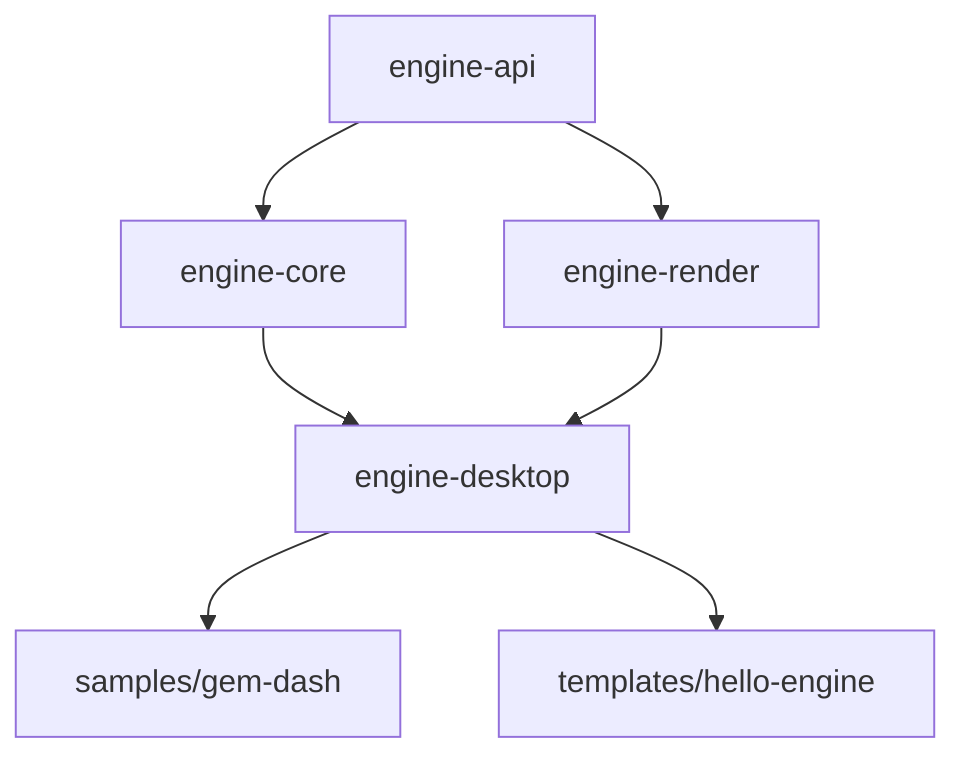

# Stratix Engine — MVP Technical Specification & Architecture

- Status: Accepted
- Owner: Lead Engineer
- Issue: STR-2
- Date: 2026-10-05
- Supersedes: n/a (first architecture spec); amends `ADR-0001` for two additive API items (see ADR-0002)
- Related: `docs/design/01-engine-features.md` (capability contract), `docs/design/02-api-ergonomics.md` (ergonomics contract), `docs/qa/quality-gate.md`, `docs/devops/*`, `ADR-0001`–`ADR-0004`, and (forward-looking, editor track) `ADR-0005`

This is the single source of truth for the engine's structure, public surface,
backend choice, runtime model, and build layout for the MVP. Exact method
signatures live in `engine-api/` (executable contract) and its JavaDoc; this
document defines the boundaries around them. If this document and the compiled
contract disagree, the contract wins and this document is fixed.

---

## 1. Scope

### 1.1 MVP definition of done

A developer can add the engine as a dependency and build and run a simple 2D
game on **desktop** with:

- **Sprites** — textured quads, texture atlases, explicit draw order.
- **Input** — polled keyboard, named actions, analog-aware movement axis.
- **Sound** — streamed/looped music and one-shot sound effects, mute.
- **Camera** — a first-class 2D camera with deadzone, smoothing, and clamping.
- **One playable sample game** — *Gem Dash* (see `docs/design/00-sample-game-design.md`).
- **Documentation** — getting-started golden path and a JavaDoc API reference.

### 1.2 In scope

`docs/design/01-engine-features.md` P0/P1 features F1–F9, implemented behind the
frozen `io.stratixops.engine` surface. Rendering is desktop/OpenGL only.

### 1.3 Explicit non-goals (post-MVP)

Deliberately out of scope for the MVP. These are named so coders do not build
them and reviewers do not expect them:

- Web/browser build, mobile, consoles (the SPI in ADR-0004 keeps the door open).
- Physics, tilemap collision, pathfinding, particles as an engine subsystem —
  collision and gameplay stay **sample-side** (per `02-api-ergonomics.md`).
- Engine-level scene graph/ECS beyond a minimal scene/entity model.
- Async/background asset streaming (loading is synchronous for the MVP).
- Editor/tooling (`docs/design/04-tooling-editor-ux.md`), hot-reload, in-game
  debug overlay (F10) — P2, deferred.
- Gamepad (F5 P1) — best-effort only if it does not risk the milestone; the API
  reserves the axis semantics for it.
- Engine-level pause (`Engine.setPaused`), mouse input, per-bus volume UI,
  sprite tint/rotation/scale. See §4.3 for the reconciliation of the doc drift.

---

## 2. Module layout

Root project `stratix-engine`, Gradle group `io.stratixops`, version `0.1.0-SNAPSHOT`,
JDK 17. `settings.gradle.kts` auto-discovers modules; the sample is included
explicitly (§6).

```
stratix-engine/
├── engine-api/        io.stratixops:engine-api      frozen public surface + SPIs (no backend deps)
├── engine-core/       io.stratixops:engine-core     runtime logic: loop, context, scene, input/audio semantics, math
├── engine-render/     io.stratixops:engine-render   desktop platform: GLFW window, OpenGL 3.3 renderer, assets, devices
├── engine-desktop/    io.stratixops:engine-desktop  bootstrap: EngineRuntime impl, backend wiring (the runnable artifact)
├── samples/
│   └── gem-dash/      io.stratixops:gem-dash-sample the playable sample (main: io.stratixops.gemdash.Main)
├── templates/
│   └── hello-engine/  io.stratixops:hello-engine    standalone onboarding starter (not a monorepo module)
├── qa-smoke/          io.stratixops:qa-smoke        test-only harness smoke (QA-owned)
├── docs/ · scripts/ · gradle/
```

Dependency direction (strict, no cycles):



- **`engine-api` is backend-neutral.** It must not import LWJGL, OpenGL, GLFW,
  OpenAL, or any other backend type. It holds interfaces, tiny value types, the
  frozen `Camera2D` behavior, and the internal SPI interfaces (`§2.1`).
- **`engine-core`** implements the loop, lifecycle wiring, `EngineContext`, the
  scene/entity model, action-map/axis semantics, the audio mixer/buses, and math
  helpers. It depends only on `engine-api`, so it is unit-testable **headless**
  (STR-10) with fake devices and a fake renderer.
- **`engine-render`** is the desktop platform layer: GLFW window/context, the
  OpenGL 3.3 renderer, texture/atlas/font loading, the built-in bitmap font, and
  the raw device implementations (GLFW input, OpenAL audio). It depends only on
  `engine-api`. GL-touching tests are tagged `gpu` (STR-11).
- **`engine-desktop`** is the only module that depends on both core and render.
  It implements `EngineRuntime`, assembles the context, and is the artifact users
  depend on. It contains no gameplay or graphics logic.

Rationale: this lets the Core Coder (`engine-core`) and Rendering Coder
(`engine-render`) build **in parallel against `engine-api`**, and keeps the
integration surface to one thin module. See ADR-0004.

### 2.1 Internal SPI (`io.stratixops.engine.spi`)

These are Lead-owned interfaces, not part of the developer-facing API. They are
public only because Java needs cross-module visibility; they are documented as
internal and may change by ADR.

- `EngineRuntime` — `void run(GameLifecycle game, EngineConfig config)`.
  `Engine.run` resolves exactly one implementation via `java.util.ServiceLoader`
  (registered by `engine-desktop`). This is how a future web backend plugs in
  without changing `Engine.run` (ADR-0004).
- `InputDevice` — raw key/button state and buffered press/release edges, polled
  once per frame. Implemented in `engine-render` (GLFW), consumed by
  `engine-core` (`DefaultInput`).
- `AudioDevice` — load/play/stop clips, load/stream/loop music, set a master
  gain, report device availability. Implemented in `engine-render` (OpenAL),
  consumed by `engine-core` (`DefaultAudio`).

No other SPI is needed for the MVP. Assets (`Assets`, `Sprite`, `TextureAtlas`,
`Font`) are graphics concerns and are implemented in `engine-render`; the
`EngineContext` factory in `engine-desktop` passes the `Assets` instance to
`engine-core`'s context implementation.

---

## 3. Public API surface

The frozen surface is `engine-api` (`docs/API.md` is the human index; JavaDoc is
authoritative). This section records the model and the MVP rulings.

### 3.1 Entry point and lifecycle

```java
EngineConfig config = EngineConfig.builder()
    .title("Gem Dash").windowSize(1280, 720).logicalViewport(640, 360).build();
Engine.run(new GemDashGame(), config);
```

- `Engine.run(GameLifecycle, EngineConfig)` — the only entry point; resolves the
  `EngineRuntime` provider.
- `GameLifecycle`: `onCreate(EngineContext)`, `onUpdate(float dt)`,
  `onRender(Renderer, float alpha)`, `onDispose()`. No base class, no required
  init order.
- `EngineContext`: `assets()`, `input()`, `audio()`, `viewport()`.
- `EngineConfig`: `title`, `windowSize` (physical, default 1280×720),
  `logicalViewport` (default 640×360), `resizable`, `vsync`; non-positive
  dimensions fail fast.

### 3.2 Rendering

- `Renderer`: `clear(int rgba)`, `draw(Sprite, float x, float y)` (centered),
  `drawText(String, float x, float y)` (top-left anchored), `pushCamera(Camera2D)`,
  `popCamera()`, and (new in v1.1) `fillRect(float x, float y, float w, float h, int rgba)`.
- Coordinate model: **world space origin top-left, +x right, +y down, units =
  logical pixels**; screen space is the same axes at logical-viewport scale.
  Angles are radians; colors are packed `0xRRGGBBAA`.
- Immediate mode, draw order = call order. World draws are bracketed by
  `pushCamera`/`popCamera`; after `pop`, draws are screen-space (HUD).
- Missing assets degrade (magenta placeholder + log); configuration/registration
  errors fail fast with the offending value.

### 3.3 Camera

- `Camera2D(Vec2 viewport)`, `position()`, `viewport()`, `follow(Vec2 target, float dt)`.
- `follow` bundles deadzone, frame-rate-independent exponential smoothing, and
  level-bounds clamping (bounds are supplied by the sample through a future
  overload/`setBounds`; see §4.3).
- `follow` is pure math and lives in `engine-api`, so it is tested headless.

### 3.4 Input

- `Input`: `bind(ActionMap)`, `pressed(String action)`, `down(String action)`,
  `axis(String action)`, `axisNormalized(String action)`.
- Poll-based, queried during the fixed update; edges buffered so a press is
  never lost. Action map bindings **merge** on re-registration.
- `axis` preserves analog magnitude and normalizes digital groups (unit diagonal,
  no speed boost); `axisNormalized` forces length 0/1.

### 3.5 Audio

- `Audio`: `music(String path, float volume) -> Music`, `toggleMute()`,
  `setMuted(boolean)`, `isMuted()`, and (new in v1.1) `sfx(String path) -> Sfx`.
- `Music`: `loop()`, `stop()`, `setVolume(float)`. One track at a time.
- `Sfx`: `play()`, `stop()`, `setVolume(float)`. Cached, overlapping,
  voice-capped. No device degrades to no-ops with one warning.

### 3.6 Assets

- `Assets`: `sprite(String path)`, `atlas(String path)`, `font(String path)`;
  path-keyed cache, decode once. `Sprite` exposes `width()`/`height()`;
  `TextureAtlas.region(String name)` returns a `Sprite`; `Font.lineHeight()`.

### 3.7 Math

- `Vec2` (mutable, reused instances; `set`, `length`, `lengthSquared`,
  `normalize`). The engine ships only tiny helpers; **collision stays sample-side**.
  Additional helpers (`clamp`, `lerp`, `approach`, overlap) are a P1 nice-to-have
  and may be sample-vendored if they risk the milestone.

### 3.8 MVP surface rulings and doc reconciliation

`docs/API.md` and `docs/GETTING_STARTED.md` were drafted ahead of the frozen
contract and drift from it. Rulings (see ADR-0002):

| Item in docs | Ruling for MVP | Action |
|---|---|---|
| `audio.sfx(path).play()` | **Add to API (v1.1).** | Implement `Sfx`; keep doc. |
| `r.fillRect(...)` (rects for flash/particles) | **Add to API (v1.1).** | Implement in renderer. |
| `Animator.of(...)` | **Sample-side.** Implement frame stepping over `TextureAtlas.region` in the sample. | Fix `API.md` + GETTING_STARTED step 10. |
| `input.released(...)`, `input.isDown(key)` | **Deferred.** Action model covers the sample. | Fix `API.md`. |
| `Engine.setPaused(boolean)` | **Sample-owned** (`paused` flag, as in `GemDashGame`). | Fix `API.md`. |
| `audio.setVolume(bus, v)` | **Deferred.** `music(path, volume)` + mute suffice. | Fix `API.md`. |
| Sprite tint/rotation/scale | **Deferred.** Pixel art is axis-aligned; pop/juice uses atlas frames. | Note in `API.md`. |
| Camera zoom/shake | **Deferred** (F7 extras). | Note in `design`. |

Doc reconciliation is tracked as a delegated DX task (see `01-task-breakdown.md`).

---

## 4. Rendering strategy

**Decision (ADR-0002): a thin LWJGL 3 + OpenGL 3.3 core backend**, not LibGDX.

- Window/context: GLFW 3 (via `lwjgl-glfw`), OpenGL 3.3 core profile, forward
  compatible, `samples=0`, no depth/stencil, alpha 8. Vsync via
  `glfwSwapInterval(1)`; if disabled, a software frame cap targets 60 FPS.
- Batching: one `SpriteBatch` — a growable dynamic vertex buffer (position, UV,
  packed color) with a single shader; auto-flush on texture change or at frame
  end. Draw order = call order; alpha blending `SRC_ALPHA / ONE_MINUS_SRC_ALPHA`.
- Textures: decoded with `stb_image` (`lwjgl-stb`); nearest filtering by default
  (crisp 1× art), configurable later. Atlas sub-regions use half-texel UV insets
  to prevent bleed (AC3.3).
- Logical viewport: render the scene into a 640×360 `Framebuffer` with nearest
  filtering, then blit to the window with **integer scaling + letterbox**
  `fillRect` bars (AC1.2). This is pixel-perfect and keeps world coordinates in
  logical pixels.
- Font: one embedded bitmap font (PNG + metrics) shipped as an engine resource;
  `Assets.font("font.pixel")` needs no file from the user.
- `fillRect` draws an untextured colored quad for full-screen flash, letterbox
  bars, and simple debug.
- Background/clear: `clear(rgba)` clears the logical framebuffer.

Why LWJGL: full control, minimal, no framework/API leak, matches the frozen
custom immediate-mode API, keeps native/classifier behavior documented in
`GETTING_STARTED.md`, and is the lower-risk fit for a purpose-built 2D engine.
Trade-off (surfaced in ADR-0002): LWJGL is desktop-only; the `EngineRuntime` SPI
isolates that so a future `engine-web` (TeaVM/WebGL) backend can be added
without touching game code. LibGDX was rejected because it would either leak a
foreign object model into the frozen API or duplicate its value with a wrapper,
and its web backend is not an MVP requirement.

---

## 5. Audio, input, and asset strategy

### 5.1 Audio

- Backend: OpenAL Soft via `lwjgl-openal`. **SFX** = WAV decoded fully into
  memory, played on pooled `Source`s with a voice cap (default 16, oldest/quietest
  stolen). **Music** = OGG streamed via `stb_vorbis` on one source; a new track
  replaces the current one.
- Mixing: a single master gain, plus per-clip volume; `toggleMute` zeroes the
  master listener gain. Buses (`master/music/sfx`) are a post-MVP extension.
- Missing device/file: catch at open, log once (`No audio device; running muted`),
  and return no-op handles so gameplay never crashes (AC6.4).

### 5.2 Input

- Backend: GLFW key/char/mouse callbacks push into a per-frame event queue;
  `InputDevice` exposes down-state and buffered press/release edges.
- `engine-core` `DefaultInput` resolves `ActionMap` actions to those raw keys,
  computes `pressed`/`down`, and implements the frozen axis semantics. Gamepad
  is best-effort P1 and must return neutral when absent.

### 5.3 Assets

- `engine-render` `DesktopAssets` resolves classpath/first, then filesystem;
  caches by path; decodes textures once. Atlas metadata is a small JSON file
  (`{ "image": "atlas.png", "regions": { name: {x,y,w,h} } }`) parsed by a
  minimal internal reader — no JSON dependency is added.
- Policy: missing sprite → magenta 1×1 placeholder + warning; missing font/atlas
  → built-in fallback; configuration errors fail fast.

---

## 6. Game loop & threading model

**Decision (ADR-0003): single-threaded, fixed-timestep with render interpolation,
on the main (GL) thread.**

```
FIXED_DT   = 1/60 s
MAX_FRAME  = 0.25 s          // spiral-of-death guard
accumulator += min(frameTime, MAX_FRAME)
while (accumulator >= FIXED_DT) { game.onUpdate(FIXED_DT); accumulator -= FIXED_DT }
alpha = accumulator / FIXED_DT
game.onRender(renderer, alpha)
```

- `onUpdate` runs at a fixed 60 Hz, so gameplay is frame-rate independent
  (AC2.1). Interpolation `alpha ∈ [0,1)` is forwarded to draws (contract).
- A long frame clamps and recovers rather than cascading (AC2.2).
- **All engine calls run on the main thread**: GL context, input polling, update,
  render, and asset loading. OpenAL's own internal threads are the only
  concurrency and are fully encapsulated by `AudioDevice`. No gameplay threads in
  the MVP. This makes core logic deterministic and headless-testable.
- Pause is **sample-owned** (`GemDashGame.paused`): updates are skipped, rendering
  continues. An engine-level pause is deferred (§3.8).
- Shutdown order: stop audio → dispose assets/GL resources → destroy window →
  return exit code 0. No leaked threads; the process terminates promptly (AC1.3).
- Vsync on by default; off uses a 60 FPS software cap.

This is the timing contract both coders implement against. `engine-core` owns
the loop; the renderer only consumes `alpha`.

---

## 7. Gradle build layout & packaging

- Root `build.gradle.kts` (QA-owned) applies Java 17 toolchain, JUnit 5, JaCoCo,
  and the per-module coverage floor to every subproject. Do not edit for
  engine-specific behavior.
- Each module has its own `build.gradle.kts` declaring only its deps:
  - `engine-api`: no dependencies.
  - `engine-core`: `api(project(":engine-api"))`.
  - `engine-render`: `api(project(":engine-api"))` + LWJGL.
  - `engine-desktop`: `api(project(":engine-core"))`, `api(project(":engine-render"))`,
    and declares the `EngineRuntime` service (`META-INF/services`).
  - `samples/gem-dash`: `implementation(project(":engine-desktop"))`; publishes
    `io.stratixops:gem-dash-sample` with `Main-Class: io.stratixops.gemdash.Main`.
- **LWJGL wiring:** use `org.lwjgl:lwjgl-bom:3.3.x` for versions; add `lwjgl`,
  `lwjgl-glfw`, `lwjgl-opengl`, `lwjgl-stb`, `lwjgl-openal`, and runtime natives
  for `natives-windows`, `natives-linux`, `natives-macos`, `natives-macos-arm64`.
  LWJGL auto-extracts natives from the classpath — do **not** pin a classifier in
  user projects (matches the `GETTING_STARTED` troubleshooting entry).
- `settings.gradle.kts`: keep auto-discovery for engine modules; add an explicit
  `include("samples:gem-dash")` (the sample is nested, so auto-discovery will not
  find it). `samples` must not be in the non-module ignore list.
- **User dependency** is `io.stratixops:engine-desktop` (one artifact that pulls
  api + core + render + natives). The onboarding template (`STR-7`) changes its
  `engine-api` dependency to `engine-desktop` and keeps `run`/`runSample` as
  wired. `runSample` resolves `io.stratixops:gem-dash-sample`.
- Publishing to Maven Local (`publishToMavenLocal`) is the MVP distribution
  path; the template's `settings.gradle.kts` composite-build fallback stays for
  monorepo development.
- `qa-smoke` and `templates/hello-engine` are excluded from the coverage gate as
  they are test-only/standalone.

---

## 8. Quality bar & coding standards

- Java 17; package root `io.stratixops.engine`; no `com.stratixops.*`.
- Public API is backend-neutral and fully JavaDoc'd (CE4). No LWJGL/GL types in
  `engine-api` or in any public signature.
- Fail-fast for programmer/config errors; degrade loudly-but-safely for runtime
  content (missing asset/device). Never swallow exceptions silently.
- Tests: JUnit 5 + AssertJ; deterministic (no sleeps/network); core tests headless
  with fakes; GL tests tagged `gpu`; per-module line coverage ≥ 0.60; `./gradlew check`
  green (see quality gate).
- No new `@Disabled` without a linked bug; flaky tests are bugs.
- Code that changes architecture beyond this spec needs a new ADR before merge.
- All core/module code is reviewed by the Lead Engineer before merge (boundary).

---

## 9. Task breakdown

See [`01-task-breakdown.md`](01-task-breakdown.md) for the per-owner task list
and acceptance criteria. In short:

- **Core Engine Coder (`engine-core`, STR-5):** loop/timing, context, scene/entity,
  `DefaultInput` + action semantics, `DefaultAudio` (buses/voice cap), math helpers;
  plus the **`engine-desktop` bootstrap** (new child issue) wiring core + render
  behind `EngineRuntime`.
- **Rendering Coder (`engine-render`, STR-6):** GLFW window/context, `GlRenderer`
  + sprite batch, texture/atlas/font loader + built-in font, `Camera2D` bounds
  integration, `GlfwInputDevice`, `OpenAlAudioDevice`; plus `fillRect`.
- **DX & Build (`STR-7`):** LWJGL deps + natives, `engine-desktop` artifact,
  template dependency switch, packaging, getting-started; and the **doc
  reconciliation** child issue for `API.md`/`GETTING_STARTED`.
- **QA (`STR-4`/`STR-10`/`STR-11`/`STR-12`):** harness/quality gate, headless core
  tests, `gpu`-tagged render tests, sample end-to-end smoke.

ADRs: [ADR-0002 rendering backend](ADR-0002-rendering-backend.md) ·
[ADR-0003 loop & threading](ADR-0003-game-loop-and-threading.md) ·
[ADR-0004 modules & runtime wiring](ADR-0004-modules-and-runtime-wiring.md) ·
[ADR-0005 editor backend recommendation](ADR-0005-editor-backend-recommendation.md).

> Forward-looking (pending board approval): [ADR-0005](ADR-0005-editor-backend-recommendation.md)
> records the Lead Engineer's backend recommendation for the Unity-parity + ImGui
> editor track requested on STR-18. It does **not** change the MVP scope above;
> the formal editor ADRs are owned by STR-19.
