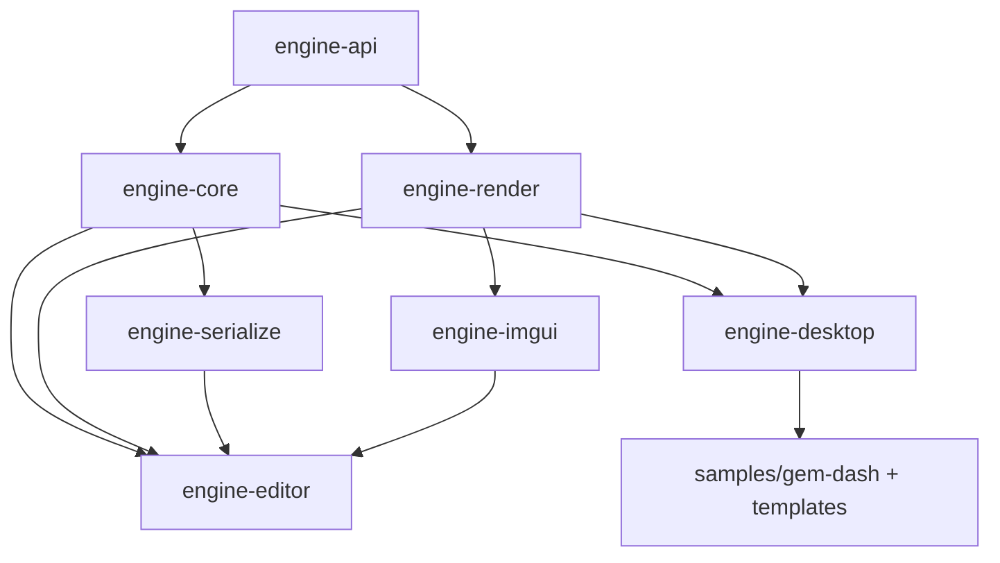

# ADR-0008: Editor module boundaries (frozen)

- Status: Accepted (freezes the Phase 1 module graph)
- Date: 2026-10-05
- Owner: Lead Engineer
- Relates to: STR-19, ADR-0002 (backend), ADR-0004 (runtime modules),
  ADR-0005 (editor backend), ADR-0006 (serialization), ADR-0007 (inspection)
- Extends: ADR-0004, which froze `engine-api`, `engine-core`, `engine-render`,
  `engine-desktop`. This ADR adds `engine-serialize`, `engine-imgui`,
  `engine-editor` and freezes the whole graph.

## Context

Phase 1 adds three modules (`engine-serialize`, `engine-imgui`, `engine-editor`)
on top of the ADR-0004 runtime modules. The two coders must be able to work in
parallel against frozen interfaces, and the boundary must keep `engine-core`
headless-testable and `engine-api` free of backend/UI/JSON types. The single
submission path (ADR-0005) must not create a cycle between core and render.

## Decision

### Frozen module graph (acyclic)

Dependency direction is **strictly one-way**. `engine-api` depends on nothing.

| Module | Depends on | Owns |
|---|---|---|
| `engine-api` | — | Frozen public gameplay surface + internal SPI (ADR-0001). Unchanged by Phase 1. |
| `engine-core` | `engine-api` | Loop/lifecycle, `EngineContext` impl, scene model (`io.stratixops.engine.scene`), `Behaviour`, inspection descriptors (`io.stratixops.engine.inspect`), input/audio semantics, math. **No** JSON, no GL, no ImGui. |
| `engine-render` | `engine-api` | GLFW/OpenGL 3.3 platform, sprite batch `Renderer`, assets, devices, and (new) an offscreen `RenderTarget` + GL texture handle for editor views. **No** scene/UI/JSON types. |
| `engine-serialize` | `engine-core` | Versioned JSON scene/prefab/settings IO, `AssetDatabase`, `.meta`/GUID, importer registry, migrations (ADR-0006). Only module that depends on Gson. |
| `engine-imgui` | `engine-render` | `imgui-java` integration, frame lifecycle, theme (tokens -> ImGui style + custom draw), generic widget kit, font atlas, headless-safe render path. **No** scene/domain types. |
| `engine-editor` | `engine-core`, `engine-render`, `engine-serialize`, `engine-imgui` | The application: docking shell, panels (Hierarchy/Inspector/Scene/Game/Project/Console), gizmos, Play/Pause/Step, undo/redo commands, property-drawer registry, Scene-view camera. |
| `engine-desktop` | `engine-core`, `engine-render` | Runtime bootstrap `EngineRuntime` for the standalone game (ADR-0004). Not used to launch the editor's Play mode (see below). |

### Key boundaries and rulings

1. **No split packages.** Every type lives in exactly one module; package roots
   are `io.stratixops.engine[.scene|.inspect|.serialize|.imgui|.editor]`.
2. **Single submission path lives in `engine-core`.** A `SceneRenderer` in
   `engine-core` walks scene components and emits draws through the frozen
   `Renderer` interface (`engine-api`). It has no `engine-render` dependency, so
   there is no core/render cycle, and it is unit-testable with a fake `Renderer`.
   The runtime Game view and the editor Scene view both use it, so they cannot
   drift (design DBG2).
3. **`engine-render` stays scene-agnostic.** Its new editor-facing surface is
   purely graphical: an offscreen `RenderTarget` (`begin()/end()`, `textureId()`,
   `width()/height()`) that implements the `Renderer` drawing contract, plus the
   shared window/context handle `engine-imgui` needs. It knows nothing about
   `GameObject`.
4. **`engine-imgui` stays domain-agnostic.** It exposes a frame lifecycle
   (`beginFrame`/`endFrame`), the theme, and generic widgets. Domain mapping
   (component -> widget, object picker) lives in `engine-editor`.
5. **`engine-editor` composes runtime pieces itself for Play mode.** Play mode
   reuses `engine-core`'s `GameLoop`/`Scene`/`SceneRenderer` and `engine-render`'s
   devices against the editor's existing GL context. It does **not** call
   `engine-desktop`'s `EngineRuntime`, which creates its own window. This keeps a
   single window, single context, and guarantees Scene/Game parity.
6. **Auto-discovery.** The root `settings.gradle.kts` already auto-includes any
   top-level directory with a build file, so `engine-serialize`, `engine-imgui`,
   and `engine-editor` light up with no settings edit. `engine-render` gains the
   ImGui natives policy (ADR-0005).
7. **Coverage gate.** New modules meet the existing per-module 0.60 line floor;
   `engine-api`/`engine-imgui` native glue may carry documented exclusions per
   the QA gate. GL/ImGui integration tests are `gpu`-tagged and opt-in.
8. **Ownership.** `engine-core`/`engine-serialize` -> Core Engine Coder;
   `engine-render`/`engine-imgui`/`engine-editor` -> Rendering & Graphics Coder;
   build/CI -> DX & Build Engineer and DevOps; tests -> QA. Lead reviews all
   merges.

## Consequences

- Coders can work in parallel: Core builds the model + descriptors behind
  `engine-api`; Rendering builds the offscreen target + ImGui kit behind
  `engine-render`; `engine-editor` integrates once both land.
- `engine-core` remains headless-testable with fakes; `engine-imgui` panel
  rendering is headless-safe.
- Any change to this graph (new module, new cross-module edge) requires an ADR
  amendment. The prior parallel-work benefit of ADR-0004 is preserved.
- `engine-editor` is the only module that couples scene, serialization, and UI;
  integration risk is confined there.

## Alternatives considered

- **Put the scene model in `engine-serialize`.** Would invert the desired
  dependency (serialization above model) and force runtime users to pull JSON.
  Rejected.
- **`engine-render` depends on `engine-core` for scene rendering.** Simpler
  submission code but creates a render -> core edge, breaks the ADR-0004 parallel
  invariant, and makes rendering non-reusable for non-scene content. Rejected; the
  `Renderer` interface is the seam.
- **`engine-imgui` depends on `engine-core` for descriptors.** Couples the UI kit
  to the domain and prevents reuse; the descriptor->widget mapping belongs in
  `engine-editor`. Rejected.
- **A single `engine-editor` megamodule also containing the ImGui kit.** Blocks
  parallel work and mixes UI-tooling with application logic. Rejected.
- **A separate `engine-platform` module for window/GL.** Cleaner in principle, but
  an extra module for Phase 1 with no present consumer; `engine-render` is already
  the platform layer. Deferred.

## Amendment (STR-32, 2026-10-05)

`engine-core`'s scene model is the STR-21 `GameObject`/`Component`/`Behaviour`
model with the final `Scene` and the core-side `SceneRenderer`; the concurrent
MVP-era `Entity`/abstract `Scene`/`SceneManager` are retired. See
[ADR-0009](ADR-0009-scene-model-reconciliation.md) for the ruling, the merge
order, and the workspace-isolation policy. This does not change the module
graph above.
